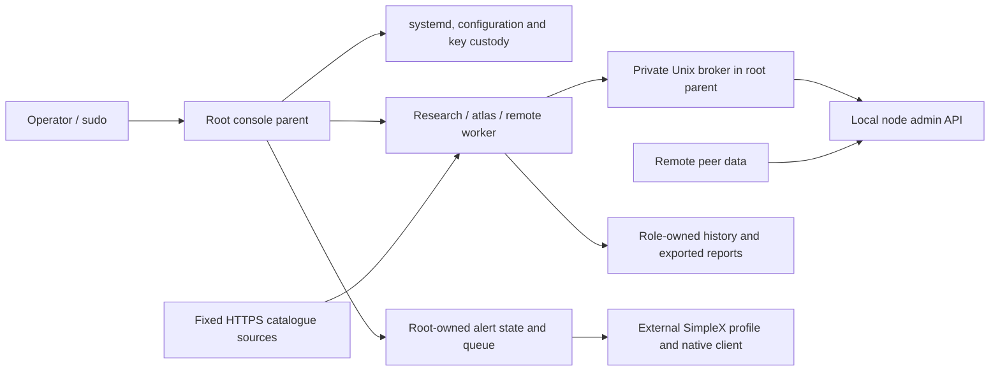

# Security attack-surface map

## Review scope

This map describes the Python console at source version **5.12.1**, reviewed at
commit [`920cde54c7795e0a02e087f22313ffef37167c4d`](https://github.com/Justsomebuddy/yggctl/tree/920cde54c7795e0a02e087f22313ffef37167c4d).
It records entry points, assets, trust boundaries and defensive review priorities.
It does not establish a vulnerability, exploitability or deployment readiness.

The accompanying [offline fuzz/property tests](FUZZING.md) document interface
contracts with bounded synthetic inputs. They were authored without execution;
their presence is not test-result or vulnerability evidence.

The review is static. No installed node, listener, effective systemd policy,
firewall or live message delivery was tested. The repository contains the
console, synthetic tests and documentation; the node, decoder, installer,
systemd units, host policy and operational data are external prerequisites.
See the [integration contract](../ARCHITECTURE.md) and
[security policy](../../SECURITY.md) for supported scope and reporting.

## Assets and principals

The assets are node private keys and identity; configuration and selected
underlay mode; service availability; integrity of privileged state and recovery
journals; privacy of metrics and alerts; and the evidence operators use in reports.

The trusted computing base includes the kernel, root operator, systemd/cgroup
custody, installed console and external executables. The console cannot protect
the host from an operator or component that already has unrestricted root access.

Workers use separate provisioned principals: `ygglab-research`, `ygglab-atlas`
and `ygglab-remote`. Instances of a role share its principal and, where present,
its store. They are not isolated from a hostile process holding the same role's
identity. Local API responses, peer-supplied fields, public catalogues, historical
records and imported archives cross data-trust boundaries even when their
transport or local file structure is valid.

## Data flow and trust boundaries

The broker gives workers a limited read interface; it does not delegate arbitrary
root commands or admin mutation methods. Management commands remain in the root
console. Reports and native message receipts are evidence with explicit limits,
not independent authentication of their sources.

## Surface inventory

| Surface | Inputs and authority | Existing controls and review limits | Source |
| --- | --- | --- | --- |
| CLI and privilege admission | Command names, options, peer URIs, keys and archive paths. Selected commands change services and configuration. | Command table, root checks and argument validation. `--apply` is specific to supported commands, not a global dry-run switch; service start/stop/restart act directly. | [Command dispatch](../../yggctl/main.py#L643) |
| External processes | Console arguments and configuration input become calls to `yggdrasilctl`, `systemctl`, `config-json`, `curl`, `gpg` and diagnostic tools. Their output becomes data. | Argument-vector execution without a shell, fixed executable paths, a restricted environment, time and output limits. Installed binaries and their custody remain external trust dependencies. | [Process execution](../../yggctl/core.py#L143), [context and paths](../../yggctl/core.py#L259) |
| Node admin sockets | Local node and stack admin responses, including observations derived from remote peers. Root management can add/remove runtime peers. | Fixed Unix endpoints, configuration/key checks and expected runtime-directory permissions. Effective socket ownership, permissions and alternate endpoints must be checked on the host. | [Admin calls](../../yggctl/core.py#L338), [guard](../../yggctl/checks.py#L418) |
| Worker-to-root IPC | Worker requests to a private Unix broker. | Parent-selected role, method allowlists, rebuilt arguments, kernel UID/PID and exact expected-unit cgroup admission, bounded request/reply sizes. The broker's admin interface targets the node socket. | [Roles and methods](../../yggctl/broker.py#L26), [admission](../../yggctl/broker.py#L99) |
| Worker sandbox | Research reads local observations; atlas acquires catalogue and remote-debug data; remote commands use bounded network operations. | Separate role identities and transient systemd restrictions. Research has AF_UNIX and a private network; atlas has IP networking and its own store; remote IP sockets are restricted to localhost. Effectiveness depends on provisioning and kernel/systemd support. | [Sandbox policy](../../yggctl/sandbox.py#L33), [identity contract](../WORKER_IDENTITY.md) |
| Catalogue and remote acquisition | Fixed HTTPS sources, ZIP/HTML catalogue data and remote API replies feed the atlas database and frontier. | URL allowlist, HTTPS-only curl, time/byte limits, bounded ZIP reads without extraction, method/schema checks and storage/frontier bounds. Transport and schema validity do not prove peer claims. | [Catalogue](../../yggctl/atlas/catalogue.py#L138), [protocol](../../yggctl/atlas/protocol.py#L30), [store](../../yggctl/atlas/store.py#L26) |
| Local state and transactions | Metrics, alerts, checkpoints, configuration preimages and recovery journals affect later actions and reports. | Custody checks, locks, bounded readers and atomic writes. Transactions admit a finite path set and compensate on failure. Custody checks cover documented members, not every possible file or continuous hostile modification. | [State custody](../../yggctl/checks.py#L136), [transactions](../../yggctl/management.py#L51), [state contract](../STATE_CUSTODY.md) |
| Backup and restore | Operator-selected archive and sidecar; decrypted archive content; full backup can include private keys. | Full backup requires an explicit GPG recipient fingerprint. Preview limits compressed/decompressed/member bytes and admits fixed regular members. `restore --apply` is disabled; sidecar/internal hashes detect corruption, not origin. | [Backup](../../yggctl/recovery.py#L65), [archive inspection and preview](../../yggctl/recovery.py#L120) |
| Alert forwarding | Root-owned queue, forwarding checkpoints, sender configuration and an external SimpleX SQLite profile/client. | Private configuration/path checks, profile lock, durable attempt journal, bounded handoff and read-only native-item evidence. Ambiguous attempts remain pending; local recording is not transport delivery or human acknowledgement. | [Forwarder](../../yggctl/telemetry.py#L705), [native handoff](../../yggctl/simplex_sender.py#L219), [integration contract](../NATIVE_HANDOFF.md) |
| Output and history | Peer fields, journal messages and role-writable history become terminal, JSON, Markdown, DOT and offline HTML output. | Sensitive-data projection/redaction; HTML escaping, script-safe JSON and CSP. History is visibly labelled unverified and mutable by its role owner. Structured or recent data is not authenticated history. | [Journal projection](../../yggctl/main.py#L449), [viewer](../../yggctl/atlas/viewer.py#L93), [history limitations](../../SECURITY.md#source-5100-trust-and-recovery-boundaries) |
| Source and build supply chain | Repository changes, CI actions, development packages and separately installed runtime programs. | Source CI declares limited permissions and pinned action revisions. Runtime Python uses the standard library, but external executables still require provenance and patch management. Source policy cannot establish effective repository protections or installed-file integrity. | [CI](../../.github/workflows/ci.yml), [development dependencies](../../requirements-dev.txt), [development boundaries](../../DEVELOPMENT.md) |

## Broker capability matrix

The parent assigns the role; request data cannot select a more privileged role.
The common local methods are `getself`, `getpeers`, `gettree`, `getpaths` and
`getsessions`.

| Role | Local admin reads | Additional admin reads | Metrics read | Persistent role store |
| --- | --- | --- | --- | --- |
| Research | Common local methods | None | Yes | Research |
| Atlas | Common local methods | `debug_remotegetself`, `debug_remotegetpeers`, `debug_remotegettree` | No | Atlas |
| Remote | Common local methods | Atlas remote methods plus `getnodeinfo` | No | None bound by the sandbox |

The underlying node admin API has broader authority than this matrix. Restricting
the broker does not replace protecting the node socket and other host access.
See [broker request handling](../../yggctl/broker.py) for exact admission rules.

## Defensive review priorities

These priorities describe assurance work, not discovered defects or severity
ratings. Use synthetic data and isolated disposable environments for any later
behavioral validation, following [verification scope](../VERIFICATION.md).

1. **Privilege boundary.** Verify actual sudo policy, role UID/GID separation,
   trusted executable/path ownership, broker socket custody, expected cgroup
   admission and effective systemd restrictions. Include lifecycle and cleanup
   behavior; an unsuccessful launcher does not by itself prove worker quiescence.
2. **Mutation and recovery.** Review agreement between files, runtime peers,
   selected mode and effective network policy. Preserve pending recovery state
   when required evidence is unavailable. Source compensation tests do not
   qualify power-loss recovery or live traffic isolation.
3. **Data handling and resources.** Maintain bounded parsing and output across
   API, catalogue, archive, database, history and report boundaries. Preserve
   explicit unknown/degraded states and provenance warnings. Byte limits do not
   automatically establish whole-process CPU or memory bounds.
4. **Keys and alerts.** Review archive access, recipient selection, sender
   profile custody, shared-profile locking and durable checkpoints. Keep queue
   admission, retention, native recording and message delivery distinct.
5. **Supply chain and integration.** Record exact source and installed binary
   identities, decoder provenance, manifest coverage and applicable security
   updates. Check effective CI/repository permissions separately from source
   declarations. A repository update does not update an installation.

## Deployment evidence still required

An installation-specific map needs its effective units and drop-ins, sudo
policy, identities/groups, owners/modes/ACLs on relevant paths, socket/listener
inventory, network policy, integrity-manifest coverage and versions/provenance of
external tools. Private configuration, keys, real peer lists, raw logs and
databases must not be included in public evidence.

This source map neither supplies those deployment components nor certifies their
configuration. Keep any operational acceptance separate from this documentation
change and follow the existing [operational limitations](../SECURITY.md).
